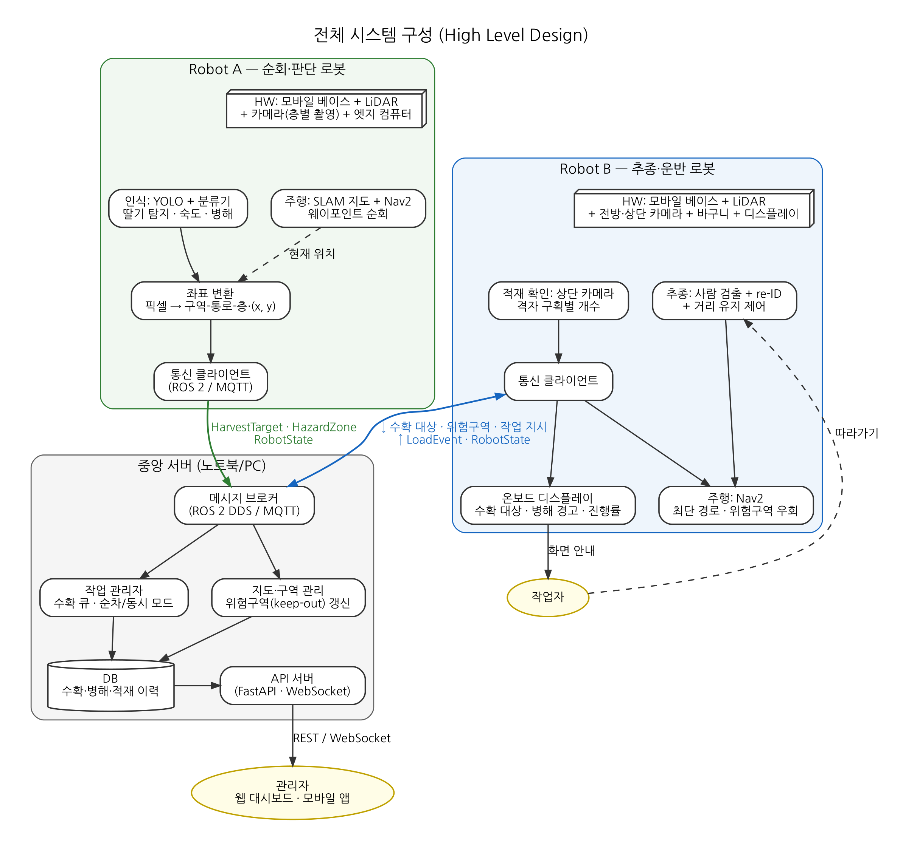
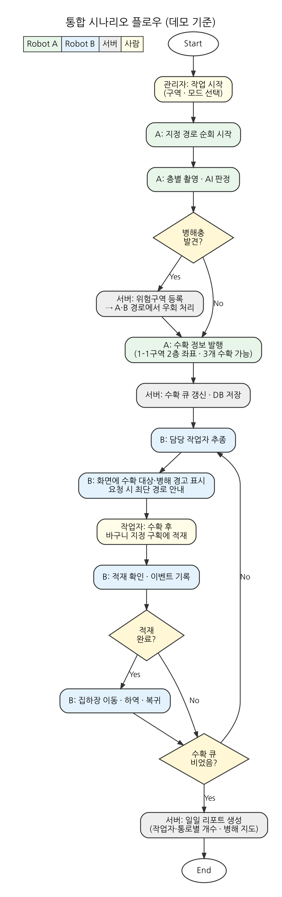
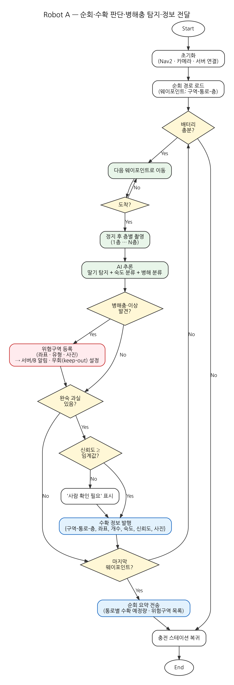
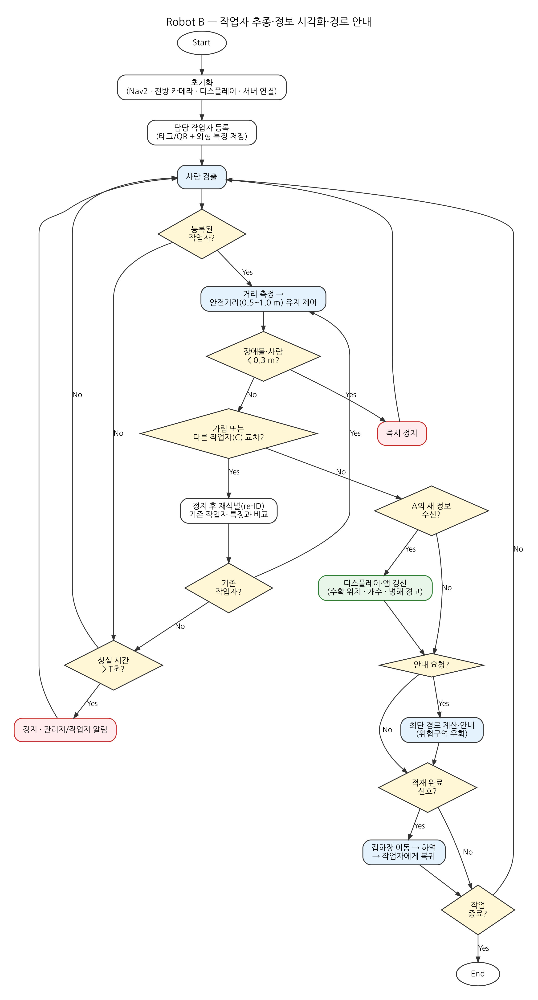
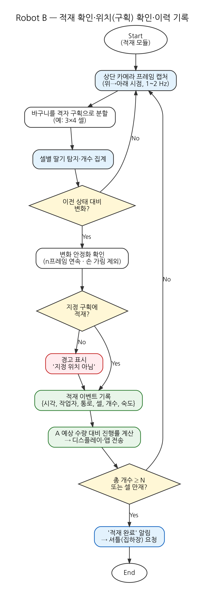
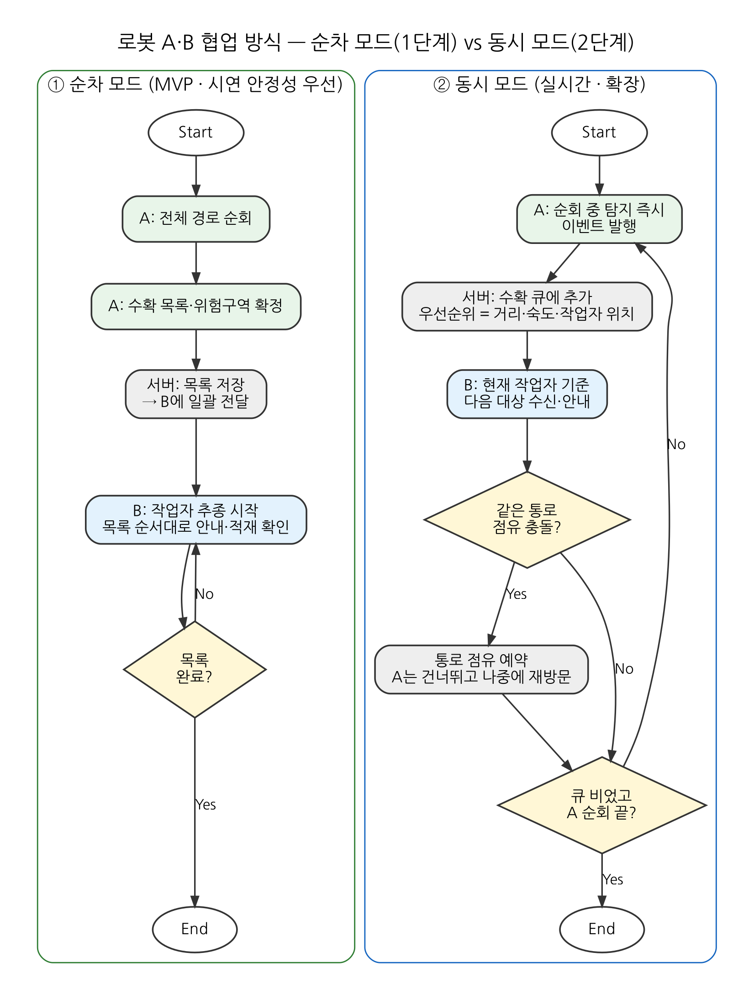

# 스마트팜 로봇 A·B 시스템 설계 — 플로우차트와 하이레벨 디자인

> 기반 자료: 손그림 기획 메모(로봇 A·B 시나리오), 배경조사 보고서(`reports/스마트팜 수확 로봇 배경조사.md`)의 비즈니스 요구사항(A-V, A-N, B-F, B-D, B-L), 수업 양식(V-모델, Process Flow Diagram, High Level Design 예시).

## 0. 설계 전제

| 항목 | 가정 (팀 장비에 맞춰 수정) |
|---|---|
| 시연 환경 | 실내 미니 재배대 4열(통로 1~4), 다층(1~3층), 딸기(실물·모형·사진), 집하장 1곳, 충전 위치 1곳 |
| 로봇 | 소형 AMR 2대(터틀봇급, ROS 2) — A: 순회·판단, B: 추종·운반 |
| 사람 | 작업자 2~3명(A, B, C 역할), 관리자 1명(대시보드·앱) |
| 규모 축소 | 현장 요구사항(300 kg 적재, ISO 안전 규격 등)은 데모 규모로 낮춰 SR(시스템 요구사항)에 반영. 원 요구사항 ID를 함께 적어 추적 가능하게 함 |

**기획 메모에서 가져온 핵심 시나리오**
- **로봇 A:** 주어진 경로(포인트 A → B …)를 돌며 웹캠으로 수확할 딸기를 확인하고, 병해충·신선도를 탐지합니다. 수확할 좌표를 전달합니다. 예: "(1-1)번 구역 (2)층 (좌표)에 (3)개 수확 가능". 병해충을 발견하면 해당 좌표를 알리고 우회하도록 안내합니다.
- **로봇 B:** 작업자 A·B 중 담당 작업자를 찾아 따라갑니다. 중간에 다른 작업자 C를 만나도 기존 작업자를 계속 따라갑니다. 수확 지점(포인트 C)까지 최단 경로를 계산합니다. 바구니 위쪽 카메라로 격자 구획별 딸기 개수를 세고, N개 이상이면 적재 완료로 판단해 모니터·앱에 개수와 위치를 보여줍니다.
- **열린 질문:** 두 로봇이 동시에 움직이는가(실시간 공유), 아니면 A가 정보를 다 보낸 뒤 B가 순차로 움직이는가? → **5장에서 답변**

---

## 1. V-모델 위치와 요구사항 계층

```
Business Requirements (배경조사 보고서: A-V, A-N, B-F, B-D, B-L)   ↔  Acceptance Test (6장)
  └ System Requirements (본 문서 2장: SR-A, SR-B, SR-S)            ↔  System Test
      └ High Level Design (본 문서 4장: 구성 · 모델 · HW · 데이터)  ↔  Integration Test
          └ Detailed Design → Coding                               ↔  Unit Test
```

## 2. 시스템 요구사항 (데모 기준)

| ID | 요구사항 | 데모 목표값 (제안) | 원 요구사항 |
|---|---|---|---|
| SR-A-01 | 웨이포인트 순회 | 지정 경로 완주 100%, 웨이포인트 도달 오차 ≤ 10 cm | A-N-01, A-N-02 |
| SR-A-02 | 딸기 탐지·숙도 판정 | 데모 테스트셋 mAP@0.5 ≥ 0.85, 완숙 정밀도 ≥ 0.90 | A-V-01, A-V-02 |
| SR-A-03 | 병해·이상 판정 | 데모 병해 샘플 정확도 ≥ 0.80, 발견 시 위험구역 등록 | A-V-06, A-V-07 |
| SR-A-04 | 좌표 변환 | 수확 정보에 구역-통로-층-슬롯과 지도 좌표 (x, y) 포함, 위치 오차 ≤ 1슬롯 | A-N-03, A-V-12 |
| SR-A-05 | 정보 전달 | 탐지 후 서버·B 수신까지 ≤ 1 s, 메시지 유실 0(재전송) | A-N-04 |
| SR-A-06 | 위험구역 우회 | 등록 즉시 A·B 경로 계획에서 해당 구역 회피 100% | A-N-08 |
| SR-A-07 | 저신뢰 처리 | 신뢰도가 임계값 미만이면 '사람 확인 필요'로 표시 | A-V-08 |
| SR-A-08 | 순회 요약 | 순회 종료 시 통로별 수확 예정 개수·위험구역 목록 전송 | A-V-04 |
| SR-B-01 | 작업자 추종 | 거리 0.5~1.0 m 유지, 작업자가 멈추면 ≤ 0.5 s 안에 정지 | B-F-01 |
| SR-B-02 | 추종 대상 식별 | 다른 작업자 교차 시험 10회 중 대상 오전환 0회 | B-F-03 |
| SR-B-03 | 안전 정지 | 0.3 m 안에 장애물·사람이 들어오면 정지 | B-F-07 |
| SR-B-04 | 최단 경로 안내 | 요청한 수확 지점까지 경로 생성, 위험구역 회피 | B-F-08 |
| SR-B-05 | 정보 표시 | 수확 대상·병해 경고·진행률 표시, 갱신 지연 ≤ 1 s, 아이콘 위주 | B-D-01, B-D-02, B-D-03, B-D-04 |
| SR-B-06 | 적재 개수 확인 | 셀별 개수 오차 ±1 이내, 총 개수 정확도 ≥ 95% | B-L-01 |
| SR-B-07 | 지정 구획 확인 | 지정되지 않은 셀에 적재하면 경고(검출률 100%) | B-L-05 |
| SR-B-08 | 적재 완료·셔틀 | N개에 도달하면 알림 후 집하장 왕복 | B-F-04 |
| SR-B-09 | 이력 기록 | 적재 이벤트 {시각, 작업자, 통로, 셀, 개수, 숙도}를 DB에 저장하고 앱에서 조회 | B-L-03, B-L-04, B-L-09 |
| SR-S-01 | 협업 모드 전환 | 순차·동시 모드를 서버 설정으로 전환 | A-N-06 |
| SR-S-02 | 통신 두절 대응 | 하트비트가 3 s 이상 끊기면 로봇 감속·정지 | A-N-07 |
| SR-S-03 | 상태 공유 | 로봇 위치·배터리·작업 상태를 1 Hz로 서버에 보고 | A-N-05 |

> 목표값은 데모 기준 제안값입니다. 장비와 테스트셋이 정해지면 팀에서 확정해야 합니다.

---

## 3. 플로우차트

### 3-1. 전체 시스템 구성


### 3-2. 통합 시나리오 (데모 1회 흐름)


### 3-3. 로봇 A — 순회·수확 판단·병해충 탐지·정보 전달


**설계 포인트**
- 웨이포인트마다 **정지한 뒤 층별로 촬영**합니다. 움직이면서 찍으면 흔들림이 생기고 좌표 매칭이 어려워집니다.
- 병해를 발견하면 수확 판단보다 먼저 처리합니다. 위험구역을 등록하면 서버가 A·B 지도에 keep-out 영역을 추가하고, 경로가 자동으로 그 구역을 우회합니다.
- 신뢰도가 낮은 판정은 버리지 않고 '사람 확인 필요'로 표시해 보냅니다. B 화면에서 작업자가 확인합니다.

### 3-4. 로봇 B — 작업자 추종·정보 시각화·경로 안내


**설계 포인트**
- 추종 대상은 처음에 **등록**합니다. 등에 붙인 ArUco/QR 마커와 옷 색·외형 특징을 함께 저장합니다.
- 작업자 C가 끼어들거나 가리면 일단 정지합니다. 재식별(re-ID)로 기존 작업자가 맞는지 확인한 뒤에만 다시 따라갑니다. 다른 사람으로 갈아타지 않는 것이 최우선입니다.
- 안전 정지는 다른 모든 판단보다 우선합니다(0.3 m).

### 3-5. 로봇 B — 적재 확인·구획 확인·이력 기록


**설계 포인트**
- 카메라를 위에서 아래로 향하게 달고, 바구니를 격자 셀(예: 3×4)로 나눕니다. 각 딸기 박스의 중심점이 어느 셀에 있는지로 셀별 개수를 셉니다.
- 손이 들어오는 순간에는 개수가 흔들립니다. n프레임 연속 같은 값일 때만 적재 이벤트로 확정해 중복·누락을 막습니다(B-L-01).
- 숙도 등급이나 통로별로 지정 셀을 정해 두고, 다른 셀에 넣으면 경고합니다(B-L-05).

### 3-6. 협업 방식 — 순차 모드 vs 동시 모드


---

## 4. 하이레벨 디자인 (Where · What · When · How Much)

### 4-1. 모듈 구성표

| 모듈 | Where (실행 위치) | What (기능) | When (주기·트리거) | How Much (목표·자원) |
|---|---|---|---|---|
| A-주행 | Robot A | SLAM 지도 + Nav2 웨이포인트 순회, keep-out 반영 | 작업 시작 시, 웨이포인트 단위 | 도달 오차 ≤ 10 cm, 0.1~0.2 m/s |
| A-인식 | 서버 GPU 또는 A 엣지 | 딸기 탐지 → 숙도·병해 분류 | 웨이포인트 정지 후 층별 1~3장 | 추론 ≤ 200 ms/장 |
| A-좌표변환 | Robot A | 픽셀 위치 + 로봇 위치 + 층 높이 → 구역-통로-층-슬롯, (x, y) | 탐지 결과마다 | 오차 ≤ 1슬롯 |
| B-추종 | Robot B / 서버 | 사람 검출 + 마커 + re-ID + 거리 제어 | 10 Hz 제어 루프 | 0.5~1.0 m 유지, 정지 ≤ 0.5 s |
| B-주행 | Robot B | 최단 경로(Nav2), 위험구역 회피, 집하장 셔틀 | 안내 요청·적재 완료 시 | 경로 생성 ≤ 1 s |
| B-적재확인 | Robot B / 서버 | 상단 카메라 격자 셀별 개수, 지정 셀 확인 | 1~2 Hz | 셀 오차 ±1, 총 정확도 ≥ 95% |
| B-디스플레이 | Robot B 화면(태블릿·폰) | 수확 대상·병해 경고·진행률, 아이콘·다국어 | 이벤트 수신 시 | 갱신 ≤ 1 s |
| 서버-브로커 | 노트북 | ROS 2 토픽 또는 MQTT로 A·B·앱 연결 | 상시 | 지연 ≤ 1 s, 재전송 |
| 서버-작업관리 | 노트북 | 수확 큐, 순차/동시 모드, 통로 점유 예약 | 이벤트 수신 시 | — |
| 서버-DB/API | 노트북 | 수확·병해·적재 이력 저장, REST/WebSocket | 상시 | SQLite(데모) → PostgreSQL(확장) |
| 대시보드·앱 | 웹 브라우저·모바일 | 지도 위 수확 위치·병해 히트맵, 작업자별 개수 | 실시간 | — |

### 4-2. 딥러닝 모델 (Deep Learning Model)

**① 딸기 탐지 + 숙도·병해 판정 (Robot A, 2단계 구조)**
1. **Model Type:** 1단계는 YOLO 계열(YOLOv8n / YOLO11n)로 딸기 위치를 찾습니다. 2단계는 잘라낸 딸기 이미지를 EfficientNet-B0 분류기로 숙도(미숙·전환·완숙·과숙)와 이상(병해·무름)으로 판정합니다.
   - 1단계 하나로 클래스를 모두 탐지하는 단일 모델도 가능합니다. 다만 2단계로 나누면 탐지와 분류 데이터를 따로 늘리기 쉽고, 분류 정확도를 올리기도 쉽습니다.
2. **Training:** 사전 학습 가중치(YOLO는 COCO, EfficientNet은 ImageNet)에서 전이 학습해 학습 시간을 줄이고 정확도를 높입니다.
3. **Dataset:** 시연 환경에서 직접 찍은 이미지(층·조명별)에 공개 데이터를 더합니다. 공개 데이터 후보는 AI Hub 시설작물·딸기 관련 데이터, 공개 딸기 병해 데이터셋입니다(이용 조건 확인 필요). 라벨링 도구는 CVAT 또는 Roboflow를 씁니다.
4. **Output:** {class, ripeness, disease, confidence, bbox} → 좌표 변환 모듈로 넘깁니다.
5. **목표:** SR-A-02, SR-A-03. 현장 기준(mAP ≥ 90%)은 보고서 A-V-01을 참고합니다.

**② 작업자 추종 (Robot B)**
1. **Model Type:** YOLO 사람 검출 + ByteTrack 추적 + 재식별(OSNet 등 re-ID 특징)입니다. 보조 수단으로 작업자 등의 ArUco 마커를 씁니다.
2. **판단 규칙:** 마커가 보이면 마커를 우선합니다. 가려지면 re-ID 유사도로 판단하고, 유사도가 임계값 미만이면 정지합니다.
3. **거리 추정:** LiDAR 스캔의 사람 다리 군집 또는 깊이 카메라를 쓰고, 단안 웹캠만 쓴다면 bbox 높이를 이용합니다.

**③ 적재 개수 확인 (Robot B)**
1. **Model Type:** ①의 YOLO 딸기 탐지 모델을 재사용합니다. 단, 위에서 본 시점 이미지를 추가로 학습시킵니다.
2. **후처리:** 셀 격자 ROI → 박스 중심점으로 셀 배정 → n프레임 안정화 → 이벤트를 확정합니다.

### 4-3. 하드웨어 사양 (Hardware Specifications, 예시)

| 구분 | Robot A | Robot B | 서버 |
|---|---|---|---|
| 모바일 베이스 | 터틀봇급 소형 AMR (ROS 2 지원) | 동일 + 바구니 거치대 | — |
| 센서 | 2D LiDAR, 측면 웹캠(층별 촬영 높이 조절 마스트) | 2D LiDAR, 전방 웹캠(추종), 상단 웹캠(바구니 내려다봄) | — |
| 연산 | 온보드 SBC(라즈베리파이급), 추론은 서버로 전송 또는 Jetson급 엣지 | 동일 | GPU 노트북(추론·DB·대시보드) |
| 표시·입력 | — | 7~10인치 태블릿 또는 스마트폰 거치 | 웹 대시보드 |
| 선택 | — | 로드셀(HX711) 무게 측정 — B-L-02 대비 | — |

> 예시 슬라이드처럼 제조사·모델명을 확정하려면 팀이 가진 장비 목록에 맞춰 위 표를 채우면 됩니다.

### 4-4. 소프트웨어 스택
- **OS·미들웨어:** Ubuntu 22.04, ROS 2 Humble, Nav2, slam_toolbox
- **AI:** Python, Ultralytics YOLO, PyTorch(EfficientNet), OpenCV, ByteTrack
- **통신:** ROS 2 토픽(로봇 간), MQTT(Mosquitto) 또는 rosbridge(앱·대시보드)
- **서버:** FastAPI + SQLite, WebSocket 실시간 푸시
- **UI:** 웹 대시보드(React 또는 Streamlit), 모바일은 반응형 웹(PWA)

### 4-5. 좌표 체계와 메시지 정의

**위치 ID:** `Z{구역}-R{통로}-T{층}-S{슬롯}`. 예: `Z1-R1-T2-S05` = 1구역 1통로 2층 5번 슬롯. 지도 좌표 (x, y)를 항상 함께 기록합니다. 반복 구조에서 SLAM 좌표만으로는 위치를 헷갈리기 쉽기 때문입니다(A-N-03).

| 메시지 | 발신 → 수신 | 주요 필드 |
|---|---|---|
| `HarvestTarget` | A → 서버 → B | id, location_id, x, y, count, ripeness, confidence, need_check, image_url, timestamp |
| `HazardZone` | A → 서버 → A·B | id, location_id, polygon, type(병해/해충/기타), severity, image_url |
| `PatrolSummary` | A → 서버 | route_id, per_row_count[], hazard_ids[], duration |
| `TaskAssign` | 서버 → B | target_ids[], worker_id, mode(순차/동시) |
| `LoadEvent` | B → 서버 | time, worker_id, row_id, cell_id, delta_count, total, ripeness, wrong_cell |
| `RobotState` | A·B → 서버 | robot_id, pose, battery, state(순회/추종/셔틀/정지), heartbeat |

### 4-6. 안전·예외 처리

| 상황 | 동작 |
|---|---|
| 0.3 m 안에 장애물·사람 | 즉시 정지(최우선) |
| 추종 대상 상실 > T초 | 정지 후 화면·앱 알림 |
| 통신 하트비트 3 s 두절 | 감속 후 정지, 재연결되면 작업 재개 |
| 배터리 부족 | 현재 작업을 서버에 반납하고 충전 위치로 복귀 |
| 같은 통로에 A·B 동시 진입 | 서버가 통로 점유를 예약해 한 대만 진입 |

---

## 5. 열린 질문 답변: 동시 vs 순차

**권장: 같은 메시지 구조로 두 모드를 모두 지원하고, 시연은 순차 모드로 먼저 완성합니다.**

| | ① 순차 모드 | ② 동시 모드 |
|---|---|---|
| 방식 | A가 전체를 순회해 목록을 확정한 뒤 B에 일괄 전달 | A가 탐지 즉시 이벤트를 발행하고, B가 실시간으로 받아 처리 |
| 장점 | 구현 단순, 충돌 없음, 시연 안정적 | 대기 시간 감소, 실제 농장 운영에 가까움(Seyyedhasani 연구: 효과는 배차에 좌우) |
| 단점 | A 순회가 끝날 때까지 B가 대기 | 통로 점유 충돌, 큐 우선순위 설계 필요 |
| 필요 기능 | 목록 저장·전달 | 수확 큐, 통로 점유 예약, 재방문 로직 |
| 권장 단계 | 1단계(MVP·중간 발표) | 2단계(최종 발표·확장) |

기획 메모의 "실시간으로 정보 계속 보내기"는 동시 모드, "A가 다 보내면 B가 순차로"는 순차 모드에 해당합니다. 서버 설정(SR-S-01) 하나로 전환되게 만들면, 발표에서 두 방식을 비교 시연할 수도 있습니다.

---

## 6. 시험 설계 (V-모델 오른쪽)

| 단계 | 시험 예시 | 대응 |
|---|---|---|
| Unit Test | YOLO 모델 mAP 측정(데모 테스트셋), 좌표 변환 함수 정답 비교, 격자 셀 배정 함수 | SR-A-02, SR-A-04, SR-B-06 |
| Integration Test | A 탐지 → 서버 → B 화면 표시까지 지연 측정, 위험구역 등록 → B 경로 우회 확인 | SR-A-05, SR-A-06, SR-B-05 |
| System Test | 작업자 교차 10회 오전환 0회, 0.3 m 정지, 통신 차단 시 정지, 적재 20회 개수 정확도 | SR-B-02, SR-B-03, SR-S-02, SR-B-06 |
| Acceptance Test | 통합 시나리오 3회 연속 완주: 순회 → 수확 안내 → 적재 확인 → 리포트 생성 | 비즈니스 요구사항(배경조사 보고서 2~5번 항목) |

---

### 부록: 그림 파일
- 슬라이드용 PNG(200 dpi)와 SVG는 `reports/system_design/img/`에 있습니다.
- 원본 Graphviz 소스는 `src/`에 있고, 수정 후 `build.sh`를 실행하면 다시 그려집니다.
