# 수확 로봇 '하루 잠재 처리량' 추정 근거와 검증 자료

> 대상: 배경조사 보고서(`reports/스마트팜 수확 로봇 배경조사.pdf`) 3쪽 표의 「하루 잠재 처리량: 사람 약 3,600개 / 로봇 약 5,760개(성공률 100%) · 약 3,800개(성공률 66%) [추정]」
> 작성일: 2026-11-14 · 원문 캡처는 2026-11-14에 해당 페이지·PDF에서 직접 촬영했고, 노란 표시가 인용 부분입니다.

## 요약

- 보고서의 수치는 **농진청 연구진의 2022년 언론 발언(개당 15초·5초, 하루 5시간·24시간)** 과 **Bac et al. 2014 리뷰의 평균 성공률 66%** 를 곱해 만든 단순 추정입니다.
- 두 출처 모두 원문으로 확인했습니다. 다만 **서로 다른 로봇의 수치를 섞었고**, **로봇 24시간 가동**과 **사람 하루 5시간**이라는 가정이 실측 자료와 맞지 않습니다.
- 실측·논문 자료로 다시 계산하면, 현재 국내 수준(개당 15초)의 수확 로봇 1대는 **숙련 작업자 약 0.4~1.2명분**입니다. "수확 팔 하나만으로는 사람 1명분 안팎이므로 판단·운반·기록을 먼저 자동화한다"는 보고서의 결론은 그대로 유지됩니다.

---

## 1. 원래 추정의 계산식

| 구분 | 계산 | 결과 |
|---|---|---|
| 사람 | 5시간 × 3,600초 ÷ 개당 5초 | 3,600개 |
| 로봇 (성공률 100%) | 24시간 × 3,600초 ÷ 개당 15초 | 5,760개 |
| 로봇 (성공률 66%) | 5,760 × 0.66 | 약 3,800개 |

### 1-1. 입력값 출처 ① — 농진청 연구진 발언 (뉴스토마토, 2022-12-07)

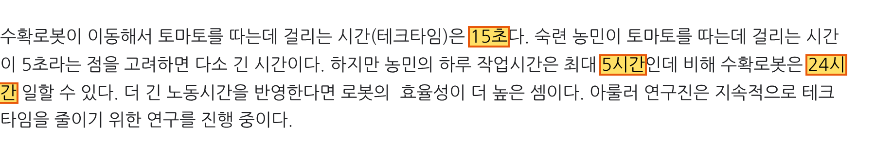

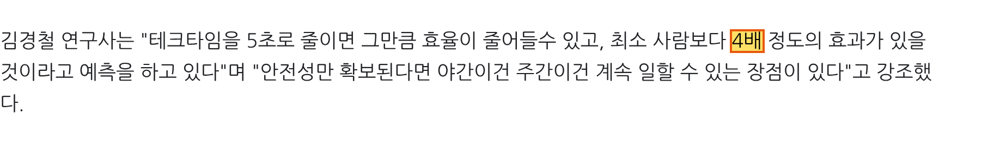

- 출처: 용윤신, 「(르포)로봇이 토마토 농사를…"정확도 92.1% 생산량 예측, 스마트농업"」, 뉴스토마토, 2022-12-07. <https://newstomato.com/ReadNews.aspx?no=1165040>
- **성격:** 측정 보고서가 아니라 농진청 연구진의 시연 현장 발언입니다.
- 기사에는 "안전성만 확보되면 야간·주간 계속 일할 수 있다"는 조건도 함께 나옵니다.
- **보고서 수정 사항:** 보고서는 이 수치의 출처를 「농민신문 2022.12」로 달았습니다. 원문 확인이 된 출처는 위 뉴스토마토 기사입니다.

### 1-2. 입력값 출처 ② — 성공률 66% (Bac et al. 2014)

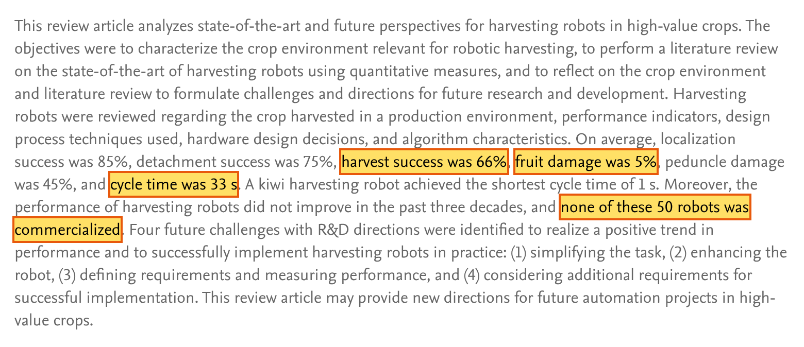

- 출처: C.W. Bac, E.J. van Henten, J. Hemming, Y. Edan, "Harvesting Robots for High-value Crops: State-of-the-art Review and Challenges Ahead", *Journal of Field Robotics* 31(6):888–911, 2014. WUR 연구 포털 초록. <https://research.wur.nl/en/publications/harvesting-robots-for-high-value-crops-state-of-the-art-review-an/>
- **내용:** 지난 30년간 개발된 수확 로봇 50대의 평균입니다. 수확 성공률 66%, 과실 손상 5%, 사이클타임 33초이고, 상용화된 로봇은 한 대도 없었습니다.
- **보고서 수정 사항:** 보고서는 이 수치를 arXiv 서베이(2207.10457) 재인용으로 표기했습니다. 그러나 그 서베이 본문에는 66%·33초 수치가 없습니다. 원출처인 위 초록으로 바꿔야 합니다.

---

## 2. 원래 추정의 한계 (왜 "추정"인가)

1. **출처 혼합:** 국내 로봇의 속도(15초)에 해외 로봇 50대의 평균 성공률(66%, 평균 사이클 33초 기준)을 곱했습니다.
2. **24시간 가동은 비현실적입니다.**
   - 충전·정비 시간이 필요합니다. 딸기 로봇 시뮬레이션은 충전에 2시간을 잡았습니다(4-3절).
   - 하루 수확량의 상한은 그날 익은 과실 수입니다. 로봇의 처리 능력이 남아도 딸 과실이 없으면 의미가 없습니다.
3. **사람 쪽 과소평가:** 네덜란드 상업 농장의 1년치 작업 기록에서 수확 인력 1인당 하루 작업은 **약 8시간**입니다(3-1절).
4. **15초의 정의가 불명확합니다.** 실패한 시도가 포함된 시간인지 기사에 나오지 않습니다.

---

## 3. 사람 수확 속도 — 실측·표준 자료

### 3-1. 네덜란드 상업 농장 1년 작업 기록 (WUR 2010)

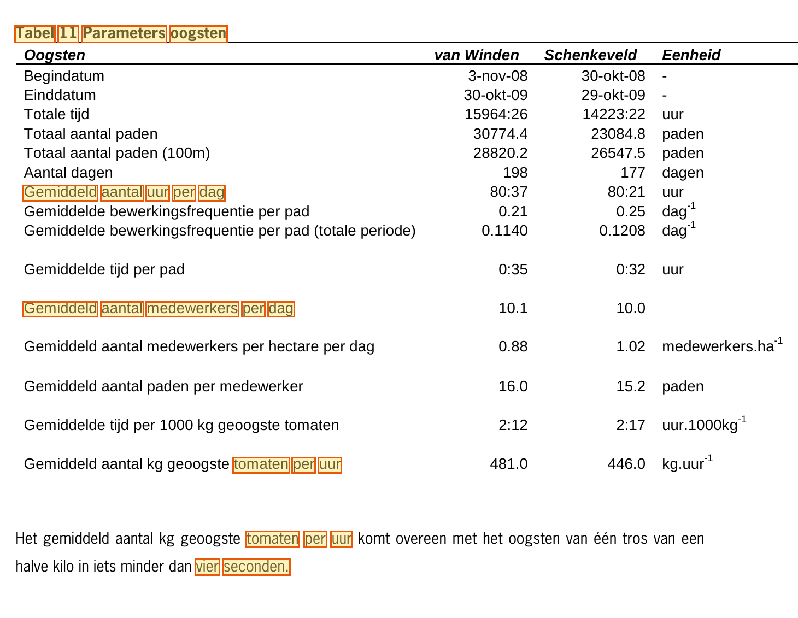

- 출처: P.J.M. van Beveren, 「Bedrijfsprocesanalyse bij moderne trostomatenteeltbedrijven」, 바헤닝언대학교 학사논문, 2010, 표 11(57쪽). 업로드 자료(Groen Kennisnet 공개본, <https://edepot.wur.nl/176100>).
- **읽는 법:**
  - 1인 시간당 수확량은 **446~481 kg**입니다. 0.5 kg짜리 트러스 하나를 **4초가 조금 안 되게**(약 3.7초) 수확하는 속도입니다.
  - 하루 평균 수확 노동은 약 80시간이고 인원은 약 10명이라, 1인당 **약 8시간**입니다.
- 수확은 작물 작업 노동의 29%로 가장 큰 작업입니다(아래 캡처, 7쪽 요약).

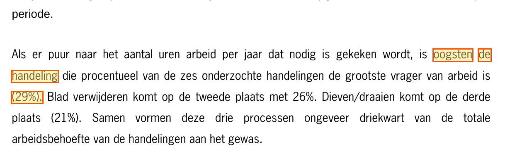

### 3-2. 네덜란드 IMAG 표준작업시간 (1983년 무렵)

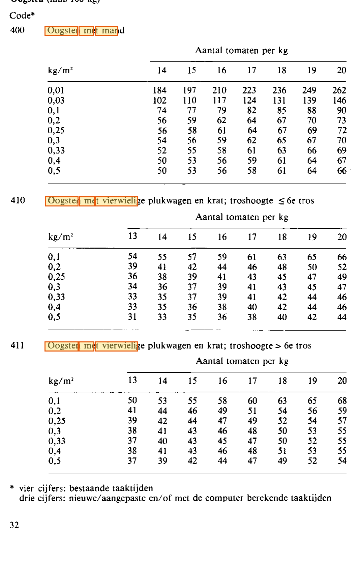

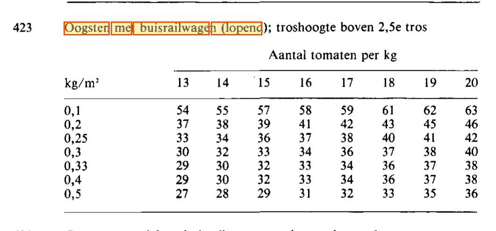

- 출처: A.T.M. Hendrix, 「Taaktijden voor de groenteteelt onder glas II」, IMAG, 바헤닝언, 1980년대(본문의 1982년 임금 기준으로 1983년 무렵 발행 추정), 32쪽. 업로드 자료(스캔본).
- **읽는 법:** 단위는 분/100kg입니다. kg당 15개, 1회 수확량 0.5 kg/㎡ 기준으로 보면 다음과 같습니다.
  - 바구니: 53분/100kg → **시간당 약 113 kg**, 과실당 약 2.1초
  - 파이프레일 대차(보행): 29분/100kg → **시간당 약 207 kg**, 과실당 약 1.2초
  - 휴식·개인 용무 시간이 포함된 표준값입니다.
- 낱개 원형 토마토(kg당 13~20개) 기준의 오래된 자료라, 절대값보다는 기준선으로 씁니다.

---

## 4. 수확 로봇 성능 — 논문·연구

### 4-1. SWEEPER 파프리카 수확 로봇 (상업 온실 4주 시험)

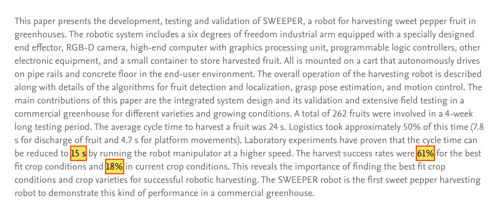

- 출처: B. Arad 외, "Development of a sweet pepper harvesting robot", *Journal of Field Robotics* 37(6), 2020. WUR 연구 포털 초록. <https://research.wur.nl/en/publications/development-of-a-sweet-pepper-harvesting-robot/>
- **내용:**
  - 262개 과실로 4주간 시험했고, 평균 사이클은 **24초**입니다. 그중 약 50%가 과실 배출과 플랫폼 이동 같은 물류 시간이었습니다.
  - 실험실에서는 15초까지 줄일 수 있었습니다.
  - 성공률은 작물 배치를 로봇에 맞춘 경우 **61%**, 일반 재배 조건에서는 **18%** 였습니다.

### 4-2. 토마토 수확 로봇 시제품 (IJABE 2025)

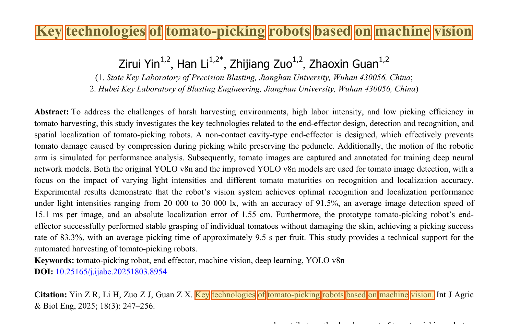

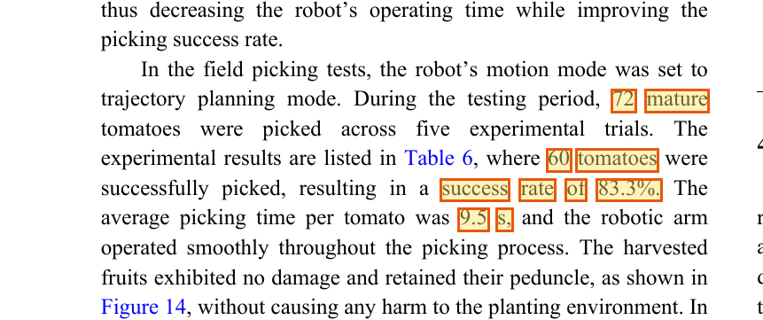

- 출처: Yin Z.R., Li H., Zuo Z.J., Guan Z.X., "Key technologies of tomato-picking robots based on machine vision", *Int J Agric & Biol Eng* 18(3):247–256, 2025. DOI 10.25165/j.ijabe.20251803.8954. <https://ijabe.org/index.php/ijabe/article/download/8954/pdf/32078>
- **내용:** 완숙 토마토 72개 중 60개를 수확했습니다. 성공률은 **83.3%**, 과실당 평균 **9.5초**이고, 과실 손상은 없었습니다. 시험 규모가 작은(5회) 시제품 결과입니다.

### 4-3. 딸기 수확 로봇 vs 작업자 처리량 시뮬레이션

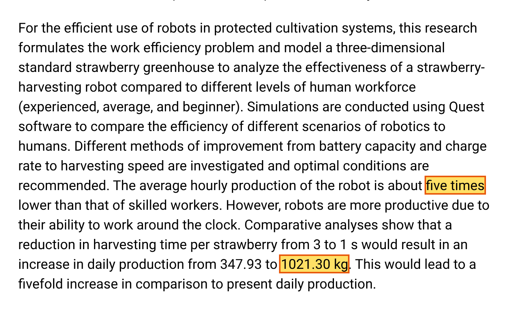

- 출처: "Analyses of Work Efficiency of a Strawberry-Harvesting Robot in an Automated Greenhouse", *Agronomy* (MDPI), 2020년 11월. 요약 소개: HortiDaily, <https://www.hortidaily.com/article/9321269/study-on-work-efficiency-of-strawberry-harvesting-robot-in-automated-greenhouse>
- **내용:**
  - 로봇의 시간당 생산량은 숙련 작업자보다 **약 5배 낮지만**, 24시간 가동으로 더 생산적일 수 있습니다.
  - 딸기 1개당 수확 시간을 3초에서 1초로 줄이면 하루 생산량이 **347.93 kg에서 1,021.30 kg**으로 늘어납니다.
- 캡처는 논문 원문이 아니라 업계 매체의 요약 기사입니다(논문 사이트는 접속 거부).

---

## 5. 업체·업계 주장 (최고 속도 또는 업체 발언이라 상한 참고용)

### 5-1. Four Growers GR-200 (토마토)

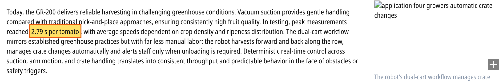

- 출처: Beckhoff 적용 사례 "Farm to fleet: engineering the future of robotic greenhouse harvesting". <https://www.beckhoff.com/en-au/company/applications-and-references/farm-to-fleet-engineering-the-future-of-robotic-greenhouse-harvesting.html>
- **내용:** 시험에서 **최고** 토마토 1개당 2.79초이고, 평균은 작물 밀도와 숙도 분포에 따라 달라집니다. 지속 처리량이 아닙니다.

### 5-2. Tortuga (딸기)

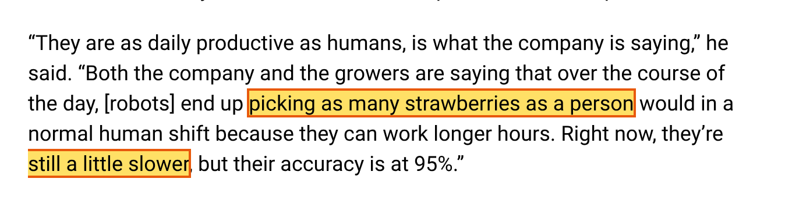

- 출처: HortiDaily, "Strawberry picking robots aim to save California growers", 2022-08-15(Spectrum News 인용). <https://hortidaily.com/article/9450057/strawberry-picking-robots-aim-to-save-california-growers>
- **내용:** 로봇은 아직 사람보다 조금 느립니다. 대신 더 오래 일해서 **하루 동안 사람의 정상 근무 시간만큼 딴다**는 것이 업체와 농가의 설명이고, 정확도는 95%입니다.
- **정정:** 이전 답변에서 "Tortuga 최고 시간당 800개"를 이 기사 출처로 소개했는데, 이 기사에는 그 수치가 없습니다. 800개는 출처를 확인하지 못한 수치로 다룹니다.

### 5-3. DailyRobotics (딸기)

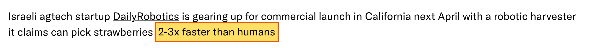

- 출처: AgFunderNews, 2025-11-17. <https://agfundernews.com/dailyrobotics-gears-up-for-commercial-launch-in-california-in-2026-with-robotic-strawberry-harvester>
- **내용:** 사람보다 2~3배 빠르다는 업체 주장입니다. 독립 검증은 없습니다.

---

## 6. 캡처하지 못한 자료 (인용 시 주의)

| 자료 | 내용 | 캡처 못 한 이유 |
|---|---|---|
| J FASE 2025 토마토 연구 (<https://journal.hep.com.cn/fase/EN/PDF/10.15302/J-FASE-2025643>) | 과실당 5.4초, 성공률 88%(모의 온실) | 사이트 접속 불가 |
| 2012년 토마토 경제성 모델 (Produce Grower 기사) | 1 ha 수확에 24시간 가동 로봇 4대 필요, 경제성 없음 | 페이지 오류. 검색 요약만 확인 |
| Dogtooth 딸기 로봇 (Ingenia) | 배터리 개선으로 교대 8시간 → 16시간, 야간 수확 | 사이트가 접속 거부(403) |
| Tortuga 배터리 (Future Farming) | 1회 충전 14~20시간 | 접속 허용 목록 밖으로 리디렉션 |
| 상업 온실 토마토 실험 | 성공률 86.67%, 성공 1건당 32.46초 | 원논문 특정 실패. 검색 요약만 확인 |
| 인도 온실 수확 시험 | 맨손 22~30 kg/h | 원문 미확인 |

---

## 7. 수정 시나리오 (권장 표기)

로봇: 개당 15초(농진청 발언), 하루 16~20시간 가동(충전 고려), 성공률 61~87%(SWEEPER 최적 조건부터 최근 논문까지)

| 시나리오 | 사람 | 로봇 1대 |
|---|---|---|
| 발언 그대로 | 5시간 × 개당 5초 = 3,600개 | 24시간 × 개당 15초 = 5,760개(이론상 최대) |
| 현실 가동 가정 | 8시간 × 개당 5초 = 5,760개 | 16시간: 3,840회 시도 × 61~87% = **2,340~3,340개** 20시간: 4,800회 × 61~87% = **2,930~4,180개** |
| 로봇 1대 환산 | — | **숙련 작업자 약 0.4~1.2명분** |

**보고서 표 교체안**

| 비교 항목 | 기존(사람) | 자동화(로봇) | 근거 |
|---|---|---|---|
| 하루 처리량 (시나리오) | 3,600개(5시간)~5,760개(8시간) | 2,340~4,180개(16~20시간, 성공률 61~87%) | [추정] 농진청 발언(뉴스토마토 2022), WUR 2010, Arad 2020, Yin 2025 |
| 로봇 1대 환산 | — | 숙련 작업자 0.4~1.2명분 | [추정] 위 시나리오 |

## 8. 출처 목록

1. 뉴스토마토, 「(르포)로봇이 토마토 농사를…」, 2022-12-07. <https://newstomato.com/ReadNews.aspx?no=1165040>
2. Bac C.W. et al., *J. Field Robotics* 31(6):888–911, 2014. <https://research.wur.nl/en/publications/harvesting-robots-for-high-value-crops-state-of-the-art-review-an/>
3. Arad B. et al., *J. Field Robotics* 37(6), 2020. <https://research.wur.nl/en/publications/development-of-a-sweet-pepper-harvesting-robot/>
4. Yin Z.R. et al., *Int J Agric & Biol Eng* 18(3):247–256, 2025. <https://ijabe.org/index.php/ijabe/article/download/8954/pdf/32078>
5. "Analyses of Work Efficiency of a Strawberry-Harvesting Robot in an Automated Greenhouse", *Agronomy*, 2020; HortiDaily 요약. <https://www.hortidaily.com/article/9321269/study-on-work-efficiency-of-strawberry-harvesting-robot-in-automated-greenhouse>
6. van Beveren P.J.M., WUR 학사논문, 2010. <https://edepot.wur.nl/176100> (업로드 자료)
7. Hendrix A.T.M., IMAG 「Taaktijden voor de groenteteelt onder glas II」, 1983년 무렵 (업로드 자료)
8. Beckhoff, Four Growers 적용 사례. <https://www.beckhoff.com/en-au/company/applications-and-references/farm-to-fleet-engineering-the-future-of-robotic-greenhouse-harvesting.html>
9. HortiDaily, 2022-08-15 (Tortuga). <https://hortidaily.com/article/9450057/strawberry-picking-robots-aim-to-save-california-growers>
10. AgFunderNews, 2025-11-17 (DailyRobotics). <https://agfundernews.com/dailyrobotics-gears-up-for-commercial-launch-in-california-in-2026-with-robotic-strawberry-harvester>
